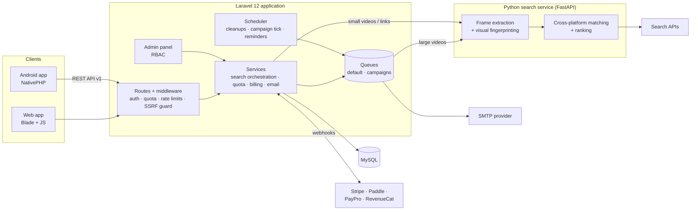

# Reverse Video Search — Engineering Showcase

**Live product:** [reverse-videosearch.com](https://reverse-videosearch.com/)

Reverse Video Search lets anyone upload a video or paste a link and find where
else that video appears online: YouTube, TikTok, Instagram, Facebook, X and
more. It is built for creators, brands and agencies who need to find reposts,
stolen content and copyright violations. Reverse *image* search is everywhere;
reliable reverse *video* search is not.

> **About this repository.** Reverse Video Search is a live commercial product,
> so its full source code is private. This repository is a curated showcase:
> the architecture, three production modules copied unchanged from the real
> codebase (with their tests), and samples of the AI-assisted workflow used to
> build it. The search and matching engine is intentionally not included.
> I'm happy to walk through the complete codebase and its commit history on a
> screen-share.

---

## At a glance

| | |
|---|---|
| **Backend** | Laravel 12, PHP 8.2+, MySQL, database queues, Laravel Scheduler |
| **Search service** | Python, FastAPI, OpenCV, NumPy, yt-dlp |
| **Frontend** | Blade, Vite, vanilla JS, AdminLTE (admin panel) |
| **Mobile** | Android app built with NativePHP (Laravel → native Jetpack Compose UI) |
| **Payments** | Stripe, Paddle (recurring billing), PayPro Global, RevenueCat (Google Play in-app purchases) |
| **Auth & access** | Email + OTP, Google / Microsoft / LinkedIn sign-in (Socialite), Spatie Permission (RBAC) for the admin panel |
| **Infrastructure** | Linux VPS, Nginx, Supervisor queue workers, Cloudflare, staging + production environments |
| **AI tooling** | Claude Code (primary AI pair-engineer, with a persistent project memory) |
| **Scale of the codebase** | ~33k lines of application PHP, 27 services, 98 migrations, **590 automated tests** across 60 test files, 2 languages (en, pt-BR) |

---

## Architecture

**Request flow (simplified):**

1. A user uploads a video or pastes a link. Large uploads are sent in 10 MB
   pieces and rebuilt on the server ([chunked uploads](modules/chunked-uploads)),
   and links are validated so the server can never be tricked into fetching
   internal addresses ([SSRF guard](modules/ssrf-url-guard)).
2. Middleware checks the user's quota (free, plan, credit pack or one-time
   unlock) and records usage.
3. Small jobs are searched inline; large videos go to a background queue so the
   request returns immediately and the user is emailed when results are ready.
4. The Python service extracts keyframes, fingerprints them and matches them
   across platforms. Results are ranked by visual similarity, so edited and
   re-uploaded copies are found, not just exact duplicates.
5. Results can be saved, shared as a public proof report, watched for new
   copies, or exported.

More detail: [docs/ARCHITECTURE.md](docs/ARCHITECTURE.md)

---

## What's in this repository

| Module | What it shows | Tests |
|---|---|---|
| [**Email campaigns**](modules/email-campaigns) | A complete bulk-email system: audience segmentation, a dedicated queue with per-minute throttling, an atomic per-recipient state machine, retries and backoff, bounce detection, automatic pause on provider rate limits, open/click tracking with signed URLs, and RFC 8058 one-click unsubscribe | 28 |
| [**Chunked uploads**](modules/chunked-uploads) | Uploading multi-GB videos through Cloudflare's 100 MB request limit: idempotent chunk upload, ownership checks, middleware that rebuilds the file so the rest of the pipeline is unchanged, and cleanup of abandoned uploads | 8 |
| [**SSRF URL guard**](modules/ssrf-url-guard) | A validation rule that stops users from making the server fetch internal addresses (cloud metadata, localhost, private networks), with the remaining risk written down rather than hidden | 24 cases |
| [**Claude Code memory samples**](claude-memory-samples) | How I keep an AI coding agent consistent across a multi-month project | — |

The module code is copied unchanged from the production codebase. Only the
small controller and route excerpts were adapted so each module reads on its
own. Each module has its own README explaining the design decisions.

---

## Product features (live)

- Reverse video search by **upload** or **link**, across major social platforms
- Visual + transcript-based matching that finds edited and re-uploaded copies
- Video metadata viewer, speech-to-text transcripts, website scanner
- **Watches**: get notified when new copies of a video appear
- Shareable **proof reports** for takedown requests
- Plans, credit packs, one-time search unlocks, discount codes, rewarded ads
- Admin panel: users, plans, quotas, API keys, CMS pages, blog, SEO, email
  campaigns, queue and cron monitoring, role-based permissions
- Android app with its own REST API, social sign-in and Google Play billing
- English and Brazilian Portuguese

---

## How it was built: AI-assisted engineering

I built this product mostly on my own, using **Claude Code** as an AI
pair-engineer. I used it for planning and implementation, while owning the
architecture, the product decisions and every review. The workflow, and what
it made possible, is described in [docs/AI_WORKFLOW.md](docs/AI_WORKFLOW.md).

In short:

- **Persistent project memory.** The real repository has a `memory/` folder
  (32 files) where architecture decisions, feature status, deploy runbooks and
  hard-won lessons are recorded, so every new AI session starts with the
  project's context and rules. [Samples here](claude-memory-samples).
- **Tests as the contract.** Features ship with feature tests that use the real
  routes (590 tests in total), so AI-written code is verified by behaviour, not
  by reading it.
- **Human review on everything.** I review every change before commit, and the
  owner's corrections are written back into memory so they stick.

---

## Contact

**Shahzeb Shakir** — Software Engineer (PHP / Laravel, Python, AI-assisted development)
LinkedIn: [linkedin.com/in/shahzeb-shakir-028aa8210](https://www.linkedin.com/in/shahzeb-shakir-028aa8210/)

© Shahzeb Shakir. All rights reserved. This code is shared for evaluation only;
see [LICENSE](LICENSE).
