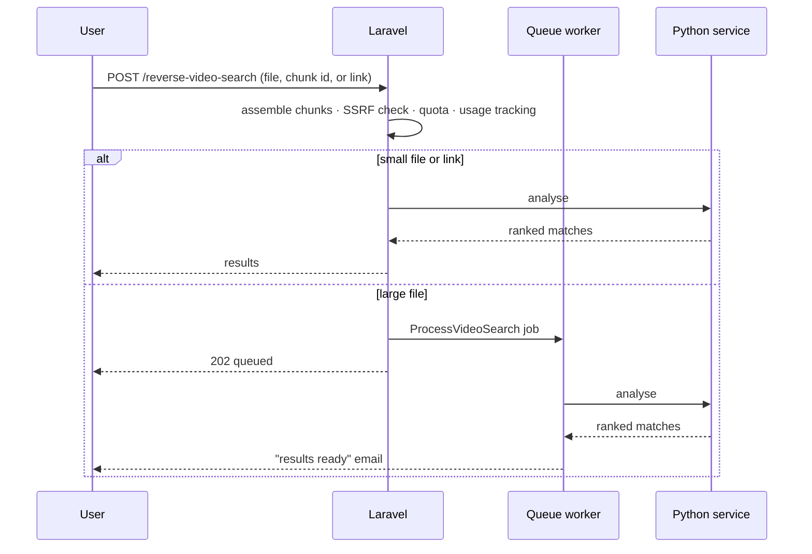

# Architecture

This document describes how Reverse Video Search is put together. It stays at
the level of components and responsibilities; the matching and ranking
internals are proprietary and not described here.

## Components

### 1. Laravel application (the product)

Everything a user or admin touches: pages, accounts, billing, quotas, the
admin panel, the mobile API, emails and scheduling.

Code is organised by responsibility:

| Layer | Responsibility |
|---|---|
| **Routes** | Separate files for public site, user area, admin panel, mobile API (`/api/mobile/v1`) and webhooks |
| **Middleware** | Auth, email verification, rate limits, search quota, usage tracking, chunked-upload assembly, locale |
| **Controllers** | Thin: validate input, call a service, shape the response |
| **Services** | All business rules: search orchestration, quota, each payment gateway, email campaigns, uploads, sitemap, translation |
| **Jobs** | Long work off the request: video searches for large files, campaign sends, renewal reminders |
| **Console commands** | Scheduled cleanup and housekeeping, recorded in an admin-visible cron history |

A rule I followed throughout: **controllers and jobs contain no lifecycle
rules of their own; services do.** That's why the same search, billing or
email logic works the same way from the website, the admin panel, the mobile
API and the queue.

### 2. Python search service

A separate FastAPI service that does the heavy lifting on video: frame
extraction (OpenCV), visual fingerprinting, fetching link-based videos
(yt-dlp), querying search providers and ranking candidates by similarity.

Keeping it separate from Laravel means:
- CPU-heavy video work never blocks PHP workers.
- It can be restarted, scaled or deployed without touching the website.
- Laravel stays the single owner of users, quotas and billing, and the Python
  service never sees any of that.

### 3. Android app

Built with NativePHP, which renders Laravel Blade screens as native Jetpack
Compose UI. It talks to the same Laravel backend through a versioned REST API
with token auth, social sign-in, chunked uploads and Google Play billing
(through RevenueCat).

## Key flows

### Search

### Billing

Four gateways sit behind one internal model: plans, subscriptions,
transactions, credit packs and one-time unlocks.
- **Webhooks are idempotent.** The same event delivered twice changes nothing
  the second time (covered by tests).
- **Google Play purchases** are verified through RevenueCat, and sandbox
  purchases are honoured only for allowlisted test accounts.
- **Quota** has a single source of truth: `QuotaService`. The website, the
  mobile app and the admin panel all read from it, and nothing hardcodes a
  limit.

### Background work

| Queue / schedule | Work |
|---|---|
| `default` queue | Large video searches |
| `campaigns` queue (own worker) | Email campaign sends, so a large send can never delay searches |
| Every minute | Email campaign tick (start scheduled sends, resume rate-limited ones, rescue stuck sends) |
| Hourly | Delete abandoned chunked uploads |
| Every 6 hours / daily | Media cleanup, renewal reminders, expiry handling |

## Security practices

- **SSRF protection** on every user-supplied URL ([module](../modules/ssrf-url-guard)).
- **Signed URLs** for unsubscribe and click tracking, so tracking redirects
  can't be abused as open redirects.
- **Ownership checks** on every user-owned resource. An unknown id and someone
  else's id return the same response, so ids can't be probed.
- **Magic-byte checks** on uploaded files, not just extension checks.
- **Rate limits** on auth, search, uploads and test-email endpoints.
- **RBAC** in the admin panel (Spatie Permission). For example, a marketer can
  edit a campaign but not send it.

## Environments

Local → staging (its own subdomain and branch) → production. All three run on
Linux behind Cloudflare, with Supervisor-managed queue workers. Schema changes
always go through new migrations, never edits to old ones (see the
[memory sample](../claude-memory-samples/feedback_migrations.md) on why).
